# Doki Doki Poyatchio!! (PlayStation) English translation v1.0

An unofficial fan translation patch for **Doki Doki Poyatchio!!** (どきどきポヤッチオ).
It contains only the changes to the game's data track, not the game: you need your own
disc image of **Doki Doki Poyatchio!! (Japan)** (SLPS-01573), the Redump version.

Doki Doki Poyatchio!! is a life simulation game. You spend a summer month in a small village,
helping your cousin run her bakery and getting to know the people who live there.

**[Download the patch (v1.0)](https://github.com/suddenlythis/doki-doki-poyatchio-psx-english/releases/tag/v1.0)**
 · [How to install](INSTALL.md) · [Checksums](SHA1SUMS.txt)

  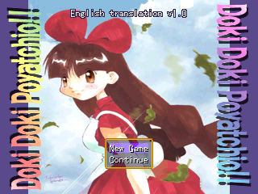

## Progress

Version 1.0: the script, the menus and the pictures with text are translated.

| Area | Status | Details |
|---|---|---|
| English text system | Done | The game's text routine was changed to draw narrow English letters and to wrap lines at spaces. A dialogue line holds up to 36 letters |
| Dialogue and narration | Done | All of it: the story scenes, every villager's lines, the errands, greetings and choices. About 13,000 strings in all, menus included |
| Menus, items and keywords | Done | Pocket, keywords, shops, Maria's Memo, save and load, system messages, item names and descriptions |
| Name entry | Done | An English letter grid replaces the kana grid. Names up to 6 letters |
| Text in pictures | Done | 18 pictures redrawn in English: the staff-credit cards on the walk into town, Maria's six town-map hints, the names on the wall, the boys' cave map and the carving in the cave |
| Opening movie | Done | The game's title added in English beneath the logo |
| Staff roll | Done | The staff roll at the end of each story |
| Tested on | DuckStation | Not tested on other emulators or on real hardware |

## About the game

Doki Doki Poyatchio!! is a life simulation game, billed in Japan as an "active communication
game": a summer holiday in a village, played on a clock that keeps running, with no battles at
all.

| | |
|---|---|
| Released | 1998, Japan only |
| Publisher | King Records |
| Developer | Studio Saizensen (planning and original concept), with M2 (programming), as named in the game's staff cards |
| Product code | SLPS-01573 |

**The story.** You are a twelve-year-old boy, and a letter arrives from your cousin Maria: the
Empire's airships have attacked the royal capital, her parents have gone to help rebuild it,
and she is running the family bakery on her own. Would you come and help for the summer
holidays? On the evening of August 1st an airship sets you down in Puerucordan, a quiet village
where a little magic still survives. The Kingdom and the Empire are drifting towards war, but in
the village life goes on, and how you spend the month is up to you.

**How it plays.** The clock runs all the time, and each of the 25 villagers keeps a daily
routine of their own. Maria's Memo tells you which bread to deliver to whom that day and what to
buy for the bakery, and finding the right person in time is half the job. You talk to people,
ask them about anyone whose name has come up (the keywords), and shout "Hiya!" at anyone you
pass: how they answer shows what they think of you. You get hungry and you get sleepy, and at
night you go to bed and can save. Six girls of the village each have a story of their own, and
the summer ends in one of many endings.

**Afterwards.** The game was directed by Toshinobu Kondo of Studio Saizensen, also known as the
character designer of Umihara Kawase. It never received a sequel, but it was re-released on
PlayStation's Game Archives in Japan in 2016, and Pia returned as a playable character, added
after launch, in Studio Saizensen's fighting game Blade Strangers (2018). The studio also
worked on Shining Hearts (2010), an RPG built around running a village bakery, which fans have
compared to it.

## Screenshots

| | |
|---|---|
| 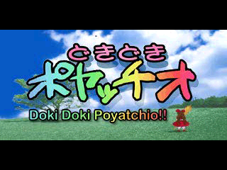 | 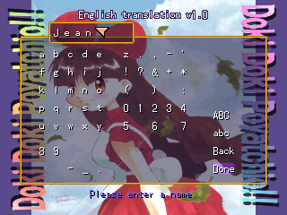 |
| 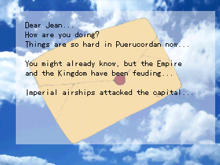 | 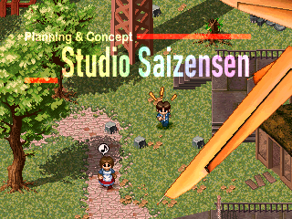 |
| 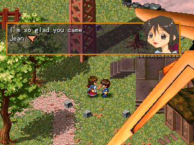 | 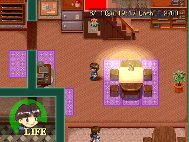 |
| 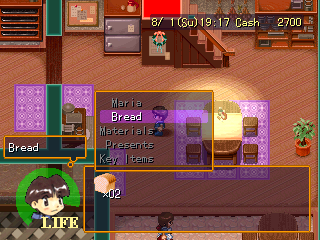 | 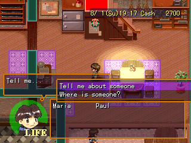 |
| 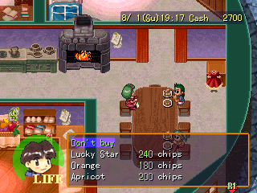 | 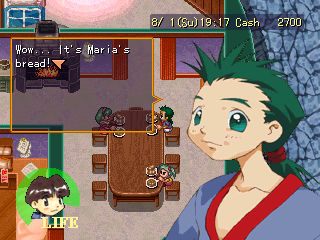 |
| 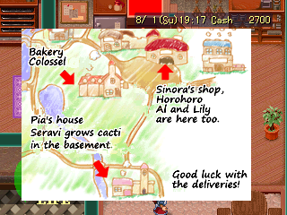 | 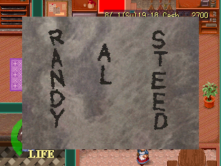 |
| 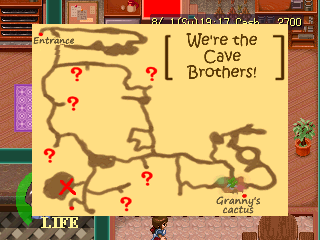 | 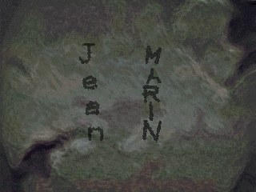 |
| 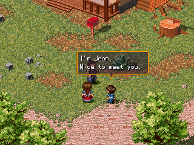 | 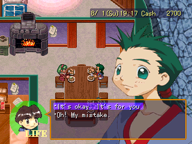 |
| 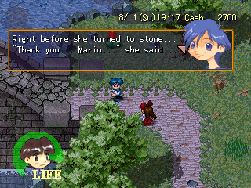 | 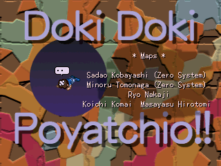 |
| 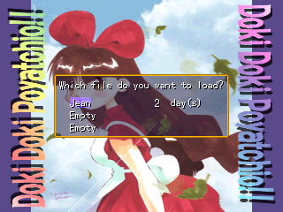 |   |

## Installing

You need the Redump version of the disc, **Doki Doki Poyatchio!! (Japan)** (SLPS-01573): one
`.cue` and one `.bin`. The `.bin` must be 711,908,064 bytes with SHA-1 `be62448e2f80879ceea35c00e68d0cc1d9c40695`.

Short version: patch the `.bin` with the `.xdelta` file, keep the file name, and open your
usual `.cue`.

The full steps, for Delta Patcher and for the command line, are in [INSTALL.md](INSTALL.md).

Start a new game after patching. Saves made with the Japanese game store the hero's name in
kana, which the English font shows as symbols.

## About this translation

**Tone.** The script keeps the tone of the original: a warm, funny summer seen through the eyes
of a twelve-year-old, with some sadness underneath. That includes its sometimes crude humor.
Nothing has been toned down, and nothing has been made harsher either.

**Voices.** About 2,000 lines are voiced in Japanese, and the voice acting is kept. The English of
the voiced lines follows the recordings closely, pausing where the actors pause. Where the text
shows the hero's name, the actors say "you" or nothing, as in the Japanese.

**Names and terms.** There are no Japanese honorifics. The relationship is carried by the
wording instead. Maria, the hero's cousin, is called by name. The money is "chips", as in the
Japanese, and the hero's shouted greeting is "Hiya!".

**The caption.** One spoken line has no text in the original game: Marin's last words late in
Rina's story. It now has an English caption. In the original the line plays after the screen
has faded to black, so it was moved to just before the fade, where the caption can be seen.

AI was used to assist with the code and translation.

## What is in English

- All dialogue and narration: the story scenes, the villagers' everyday lines, greetings,
  errands, deliveries and choices, with each character's voice kept.
- Menus and system messages: the pocket, keywords, shops, Maria's Memo, the pause screen, save
  and load, the memory card messages.
- Item names and descriptions, keywords and shop lists.
- The name-entry screen, as an English letter grid.
- Pictures with text, redrawn in English: the four staff-credit cards on the walk into town,
  Maria's six town-map hints, the names scratched on the wall and the boys' cave map.
- The names carved on the cave wall: "MARIN" is redrawn, and the hero's name is carved in
  English letters from whatever you typed at the start.
- The game's title, added beneath the logo in the opening movie.
- The staff roll.
- A caption for the one spoken line that has no text in the original.

## What was changed in the game

Nothing about the rules, the story, the schedules or the content was changed.

Text
- The game draws Japanese characters at a fixed width. The patch changes its text routine to
  draw narrow English letters, so a line holds about twice as many letters, and to wrap lines at
  spaces instead of at any character.
- Strings that came out longer than the Japanese were moved, and the scripts' references to them
  updated.

Interface
- The name-entry screen uses an English grid. Names can be up to 6 letters.
- Item names have room for 12 letters, so some are shortened.
- Save slots show the day count as "N day(s)".

Pictures
- 18 pictures with Japanese text were redrawn in English: the staff-credit cards, the town-map
  hints, the wall names, the cave map, the cave carving and the scratched letters the game uses
  to carve the hero's name.
- The opening movie has the game's title added in English beneath the logo.

Scenes
- In one scene late in Rina's story, Marin's last spoken line now comes just before the fade to
  black instead of after it, and has a caption.

## Not translated

- The songs: the opening theme and the ending songs are not subtitled.
- Small signs drawn into the town scenery.

## Known issues and limits

- Item names in the pocket are limited to 12 characters, so about 50 are abbreviated (for
  example "Choco Crois").
- Save slots show the day count as "N day(s)".
- Words longer than a line still break in the middle.
- Removing the Japanese notes from the town maps left a few visible marks in the artwork.
- A six-letter name runs off the bottom of the cave-carving close-up.
- If you have a save from the Japanese game, the hero's name in it shows as symbols, because
  that name was typed in Japanese letters. Start a new game to enter a name in English.

## Technical

- One file of the disc image is changed: the data track, the only track. It stays the same size.
- The patch is made against the Redump image (SHA-1 `be62448e2f80879ceea35c00e68d0cc1d9c40695`) and refuses any other file.
- Save states made on the Japanese game keep the old program and text in memory. Load the game
  normally instead.
- Tested in DuckStation. Not tested on other emulators or on real hardware.

## Version history

| Version | Date | Notes |
|---|---|---|
| v1.0 | 2026-11-23 | First release. Full script, menus, item names, English name entry, pictures with text, the opening movie title and a caption for the one untexted voice line. Not yet played through |

---

This is an unofficial, non-commercial fan work. Doki Doki Poyatchio!! and everything in it
belong to their owners. The patch contains no game data that can be used without an original
disc image.
